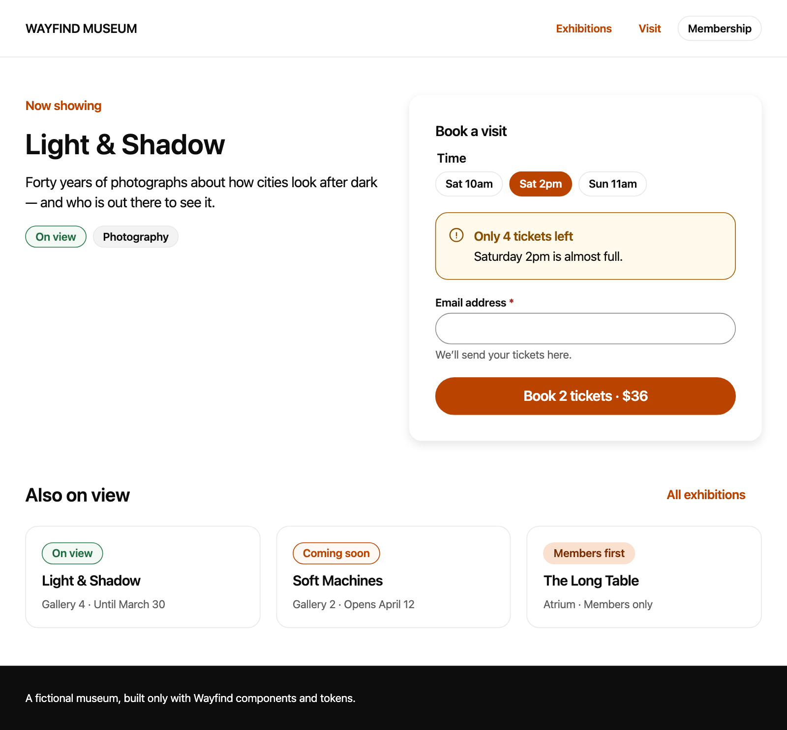
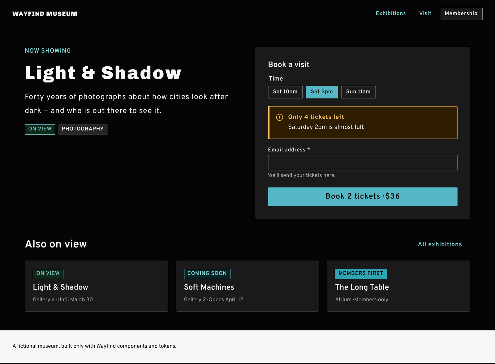
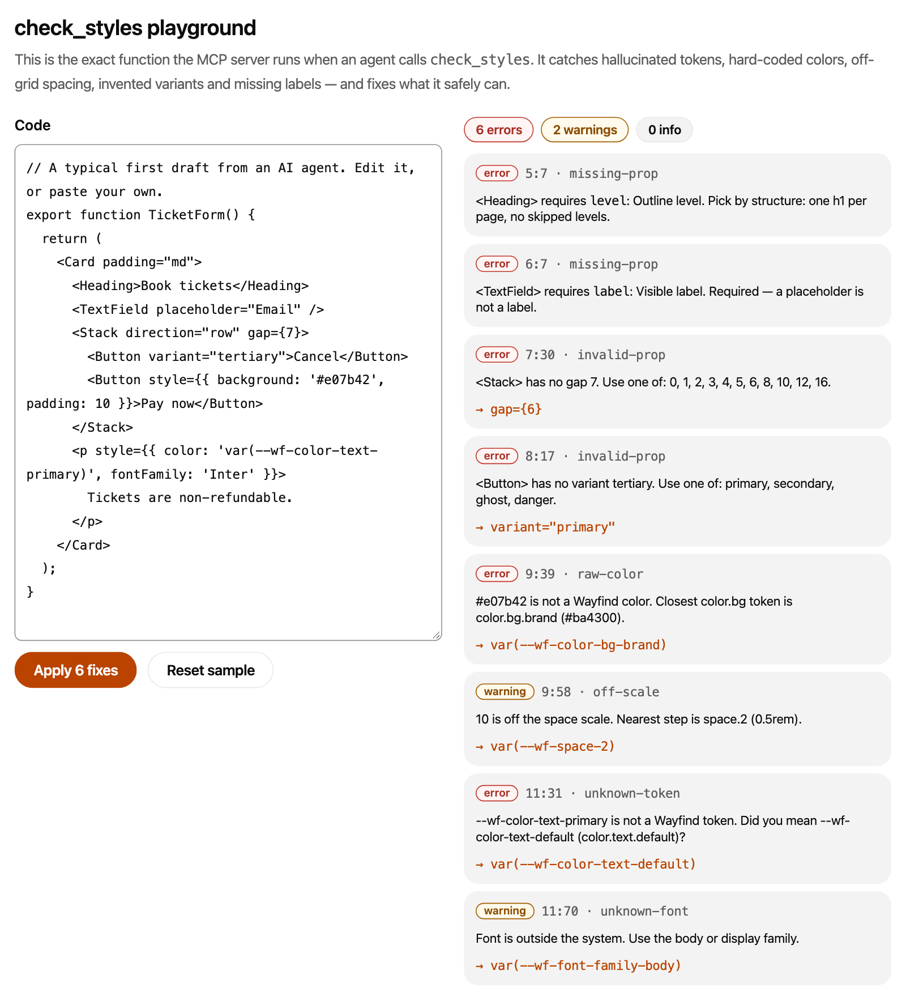
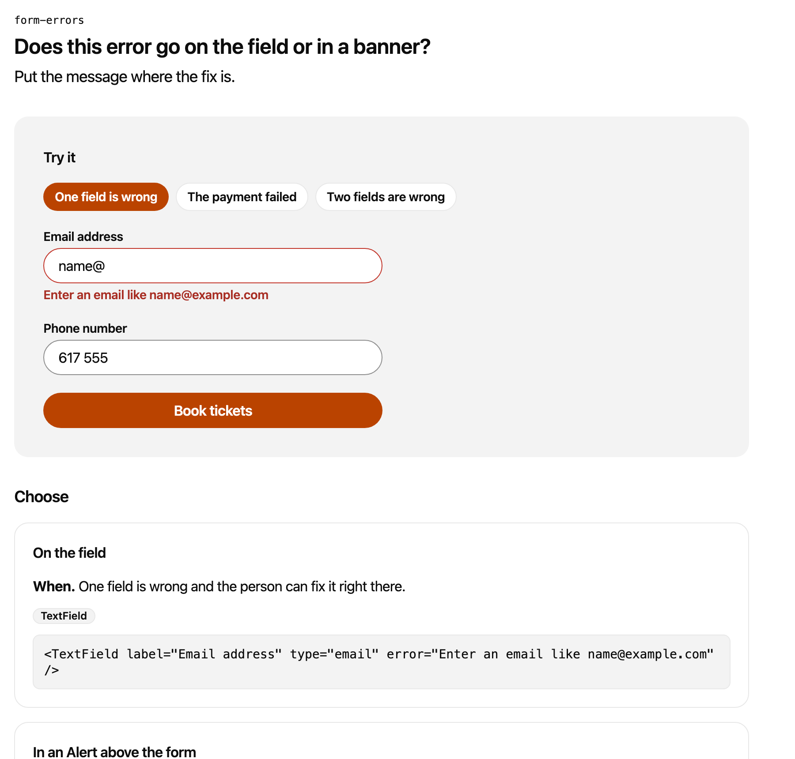
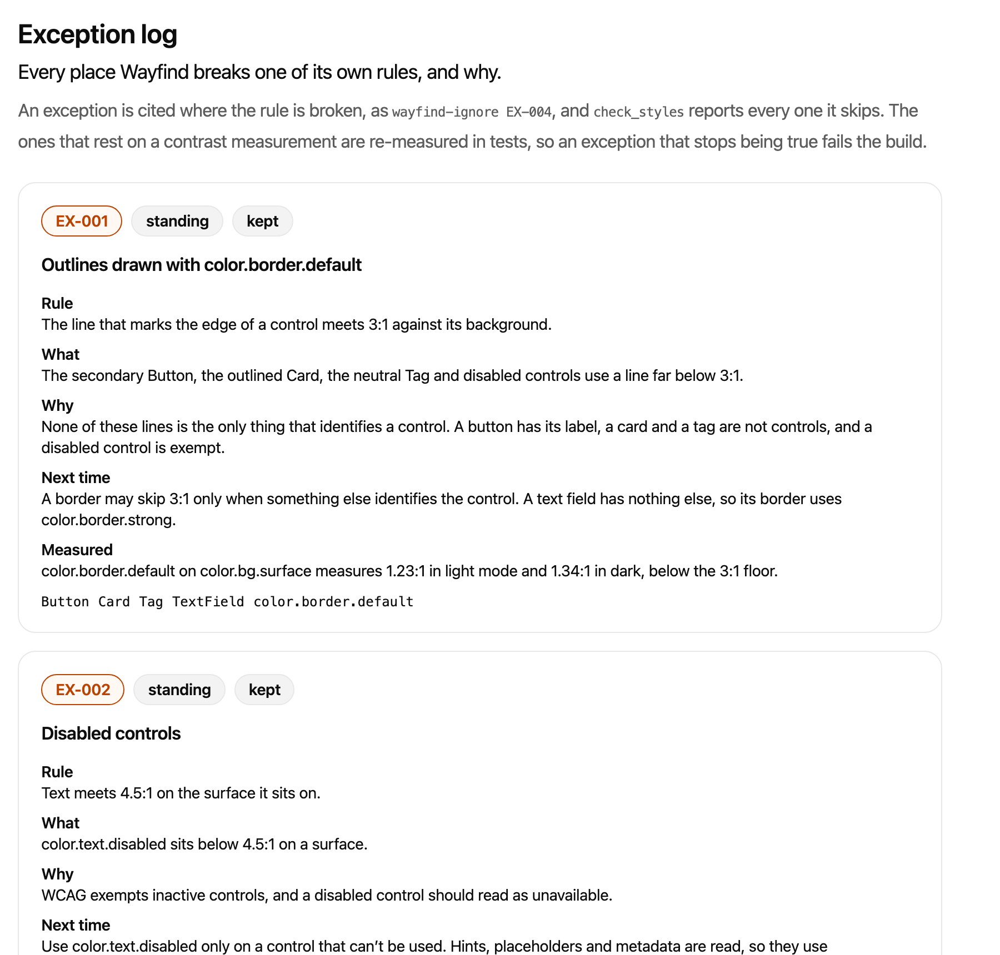
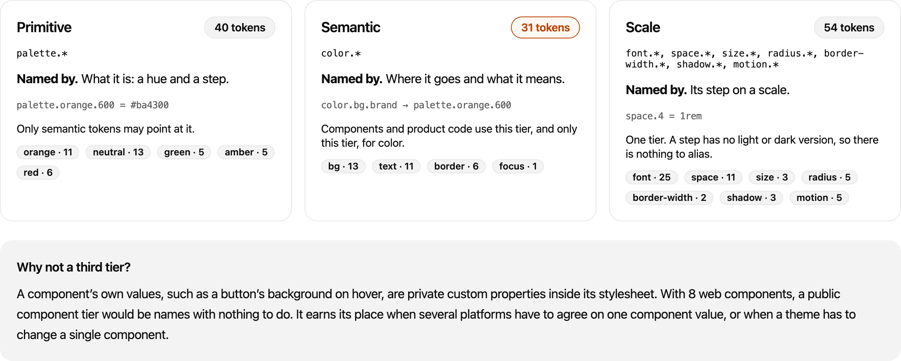

# Wayfind

**A small design system for humans and AI agents.**

[](https://github.com/xuewei-j/wayfind-design-system/actions/workflows/ci.yml)
[Live Storybook →](https://xuewei-j.github.io/wayfind-design-system/)

A growing share of UI code is now written by AI agents in Cursor, Claude Code and ChatGPT. They work fast, but they don't
know your design system: they hard-code `#3b82f6`, invent `variant="tertiary"`, and ship inputs without labels.

Wayfind treats agents as a second audience. The same source that documents each component for people in Storybook is
served to agents through an [MCP](https://modelcontextprotocol.io) server, together with a linter that checks — and
fixes — the code they write.

```
tokens.json ──┬──► tokens.css ─────────────────► components ──► Storybook   (people)
              └──► token API ──┐
component registry ────────────┤
decision patterns, exceptions ─┴──► MCP server ──► Claude · Cursor · ChatGPT (agents)
```

| | |
| --- | --- |
|  |  |
| *A full page built only from Wayfind components and tokens.* | *Dark mode comes from the semantic token layer.* |


*The `check_styles` playground in Storybook runs the same function the MCP server exposes to agents.*

## Three layers, not two

A component library answers *how do I build this?* Tokens answer *what does it look like?* Neither answers *which one
do I use here, and when is it fine not to?* That judgment usually stays in people's heads and gets argued again in
every review. Wayfind writes it down as data, so people and agents read the same answer.

| Layer | Answers | In Wayfind |
| --- | --- | --- |
| Tokens | What does it look like? | 125 tokens. Color has two public tiers: 40 palette values and 31 semantic colors. [Token architecture →](docs/TOKENS.md) |
| Components | How is it built? | 8 React components, each with machine-readable docs. |
| Decision patterns | When do I use which? | 7 questions a team keeps re-arguing, each with its options, the condition that selects each, and what to avoid. [Decision patterns →](docs/DECISION-PATTERNS.md) |
| Exception log | When is it fine not to? | 6 recorded exceptions, each with a reason and a "next time". Cited in code as `wayfind-ignore EX-004`. [Exception log →](docs/DECISION-PATTERNS.md#exception-log) |

| | |
| --- | --- |
|  |  |
| *A decision pattern: one question, its options, and a live example of each situation.* | *The exception log. Contrast claims are re-measured from the tokens.* |


*Two tiers for color and one for scales. The counts come from `tokens.json`, so the page can't go out of date.*

## What's inside

| Package | What it is |
| --- | --- |
| [`@wayfind/tokens`](packages/tokens) | Design tokens in the W3C [DTCG](https://www.designtokens.org/) format. One JSON file becomes CSS custom properties (light + dark), a typed JS API, and an **accessibility contract**: 38 color pairings × 2 modes that must pass WCAG AA or the build fails. |
| [`@wayfind/react`](packages/react) | Eight accessible React components — Button, TextField, Tag, Card, Alert, Stack, Heading, Text — plus a **registry**: machine-readable docs for each one (props, do/don't, accessibility notes, examples), the **decision patterns** and the **exception log**. |
| [`@wayfind/mcp`](packages/mcp) | An MCP server (stdio + Streamable HTTP) with seven read-only tools, six resources and a prompt. Its core is plain TypeScript, so Storybook runs it in the browser. |
| [`apps/docs`](apps/docs) | Storybook: foundations, components, decision patterns, a composed page, and interactive demos of the agent tools. |

## The MCP server

| Tool | What an agent uses it for |
| --- | --- |
| `list_decisions` | Ask what the team already decided, in plain words: "where does a form error go". |
| `get_decision` | One decision pattern in full: options, the condition for each, what to avoid, recorded exceptions. |
| `list_components` | See what exists before writing UI. |
| `get_component` | Props with allowed values, do/don't, accessibility notes and examples for one component (Markdown). |
| `search_tokens` | Find a token by intent (`"muted text"`), name (`"space"`) or by pasting the color it was about to hard-code. |
| `check_styles` | Lint a CSS/JSX snippet: unknown or primitive tokens, raw colors, off-grid spacing/radius/type, off-system fonts, invalid props, missing required props. With `fix: true` it returns the corrected code and only the issues that need judgment. It also lists every exception it skipped, and rejects a `wayfind-ignore` that gives no reason. |
| `check_contrast` | WCAG contrast between tokens or colors, in either mode, with passing alternatives. |

Resources: `wayfind://guidelines`, `wayfind://tokens.css`, `wayfind://tokens/architecture`, `wayfind://components/{name}`,
`wayfind://decisions/{id}`, `wayfind://exceptions`. Prompt: `build-ui`.

A typical agent loop: *decide → list → get → write → `check_styles` → fix → `check_styles`*. For example, given

```tsx
<Stack direction="row" gap={7}>
  <Button variant="tertiary">Cancel</Button>
  <Button style={{ background: '#e07b42', padding: 10 }}>Pay now</Button>
</Stack>
<TextField placeholder="Email" />
```

`check_styles` reports `gap={7}` (off the scale), `variant="tertiary"` (doesn't exist), the hard-coded light orange, which fails contrast
with white text (→ `var(--wf-color-bg-brand)`), `padding: 10` (→ `var(--wf-space-2)`) and the missing `label`. With `fix: true` the first
four are rewritten; the label is left for the agent to write, because only it knows what the field is for.

### Use it

```bash
pnpm install && pnpm build

# Claude Code — already configured for this repo in .mcp.json; or add it anywhere:
claude mcp add --transport stdio wayfind -- node /path/to/wayfind-design-system/packages/mcp/dist/bin.js

# Remote clients: Streamable HTTP on http://127.0.0.1:3333/mcp
pnpm --filter @wayfind/mcp start:http
```

For Claude Desktop or Cursor, add the same command to the client's `mcpServers` config:

```json
{ "mcpServers": { "wayfind": { "command": "node", "args": ["/path/to/wayfind-design-system/packages/mcp/dist/bin.js"] } } }
```

## Using the components

```tsx
import '@wayfind/tokens/tokens.css';
import '@wayfind/react/styles.css';
import { Button, Stack, TextField } from '@wayfind/react';

<Stack as="form" gap={5}>
  <TextField label="Email address" type="email" hint="We’ll send your tickets here." />
  <Button type="submit">Book tickets</Button>
</Stack>
```

Fonts: none to load. The font tokens use the system stack, which is SF Pro on Apple platforms.

## How the pieces stay honest

The point of the project is that docs for people and docs for agents **can't drift apart**. Tests enforce it:

- `defineMeta<Props>()` makes TypeScript require a doc entry for every prop a component declares.
- Each component's registry entry must list exactly the color tokens its CSS reads.
- Component CSS may only use semantic tokens: no hex values, no palette tokens.
- The component library must pass its own `check_styles` linter.
- Every documented foreground/background pair must meet WCAG AA in light and dark mode.
- Components are tested with Testing Library and axe-core; the MCP server is tested end to end over in-memory and HTTP transports.
- Every built story is scanned with axe-core in real Chromium, in light and dark mode — this caught a bug the jsdom tests
  couldn't (see decision 8).
- A decision pattern may only point at components that exist, and every example in it has to pass the linter.
- Every `wayfind-ignore` in the library cites a recorded exception. The linter rejects an ignore with no reason.
- An exception that rests on a contrast measurement is re-measured in tests, in light and dark. If the tokens change and
  it stops being true, the build fails and the exception is retired.
- `docs/TOKENS.md` and `docs/DECISION-PATTERNS.md` are generated from the same data the MCP server serves, and checked
  as file snapshots.

```bash
pnpm test          # 170+ tests across the three packages
pnpm docs:generate # rewrite docs/TOKENS.md and docs/DECISION-PATTERNS.md from the data
pnpm typecheck
pnpm storybook     # http://localhost:6006
pnpm audit:a11y    # after build-storybook; needs `pnpm --filter @wayfind/docs exec playwright install chromium` once
```

## Design decisions

Short version below; the reasoning and trade-offs are in [docs/DECISIONS.md](docs/DECISIONS.md).

- **Only Brand / Primary carries white text.** CTAs use `#BA4300` (5.40:1 with white). The lighter oranges `#D95F27`
  (3.74:1) and `#E07B42` (2.97:1) fail AA with white, so they never carry white text.
- **Text and type follow the product design system.** Text grays `#0D0D0D` / `#5D5D5D` / `#8F8F8F`; SF Pro at 400 and 600,
  with a 12–36px ramp where every size has its own line height and letter spacing.
- **Two token layers.** Palette primitives → semantic intents (`color.text.muted`, `color.bg.brand`). Dark mode lives
  entirely in the semantic layer, so components don't know it exists. Why two and not three is in
  [docs/TOKENS.md](docs/TOKENS.md).
- **Decisions are data.** The choices a team re-argues (error on the field or in a banner?) sit in the registry next to
  the components, so Storybook and agents get the same answer.
- **Exceptions are records, and they can expire.** Every rule the system breaks has an id, a reason and a "next time".
  The ones that depend on a measurement are re-measured.
- **Plain CSS + data attributes** (`data-variant="primary"`) instead of CSS-in-JS: no runtime, works with any framework,
  and the generated markup is easy for agents and devtools to read.
- **Spacing is typed.** `Stack gap` only accepts steps on the 4px scale; anything else is a compile error.
- **A regex linter, on purpose.** No parser dependency means it runs in a browser and inside an MCP call in milliseconds.
  The trade-off (and when I'd switch to an AST) is in the decisions doc.

## Project structure

```
packages/
  tokens/   tokens.json (DTCG) → resolver, CSS, contrast contract
  react/    components/<Name>/{Name.tsx, Name.css, Name.meta.ts} + registry
            decisions/<id>.ts (decision patterns) + exceptions.ts (the exception log)
  mcp/      core/ (pure functions) → server.ts (MCP) → bin.ts (stdio | --http)
apps/
  docs/     Storybook
```

## Credits

A project by **Xuewei Jiang** — product designer, [xueweijiang.com](https://www.xueweijiang.com). Brand color, text colors and
type follow the product design system.

MIT licensed.
