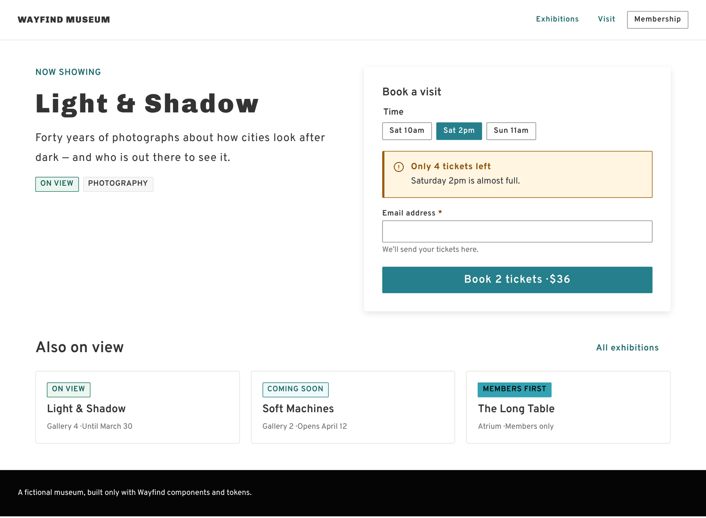
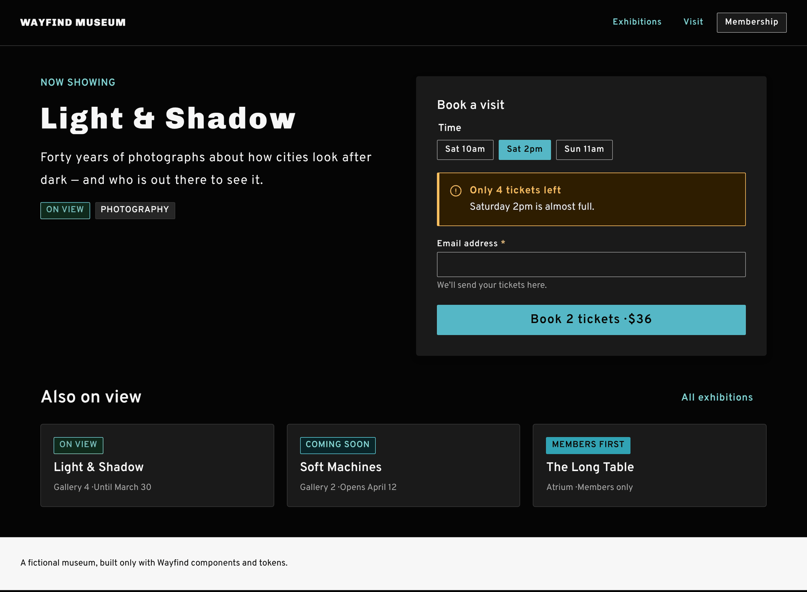
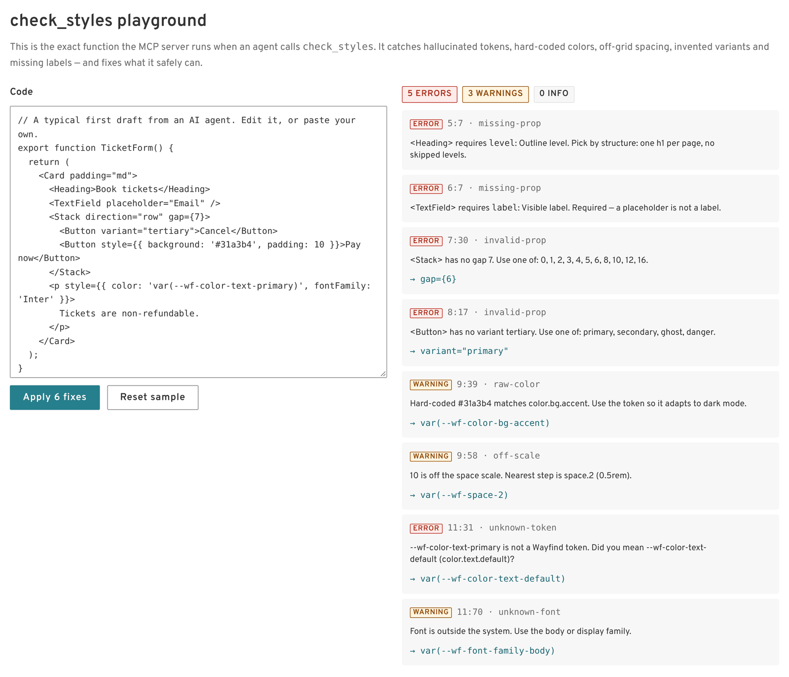

# Wayfind

**A small design system for humans and AI agents.**

[](https://github.com/xuewei-j/wayfind-design-system/actions/workflows/ci.yml)
[Live Storybook →](https://xuewei-j.github.io/wayfind-design-system/)

A growing share of UI code is now written by AI agents in Cursor, Claude Code and ChatGPT. They work fast, but they don't
know your design system: they hard-code `#3b82f6`, invent `variant="tertiary"`, and ship inputs without labels.

Wayfind treats agents as a second audience. The same source that documents each component for people in Storybook is
served to agents through an [MCP](https://modelcontextprotocol.io) server, together with a linter that checks — and
fixes — the code they write.

```
tokens.json ──┬──► tokens.css ─────────────────► components ──► Storybook   (people)
              └──► token API ──┐
component registry ────────────┴──► MCP server ──► Claude · Cursor · ChatGPT (agents)
```

| | |
| --- | --- |
|  |  |
| *A full page built only from Wayfind components and tokens.* | *Dark mode comes from the semantic token layer.* |


*The `check_styles` playground in Storybook runs the same function the MCP server exposes to agents.*

## What's inside

| Package | What it is |
| --- | --- |
| [`@wayfind/tokens`](packages/tokens) | Design tokens in the W3C [DTCG](https://www.designtokens.org/) format. One JSON file becomes CSS custom properties (light + dark), a typed JS API, and an **accessibility contract**: 38 color pairings × 2 modes that must pass WCAG AA or the build fails. |
| [`@wayfind/react`](packages/react) | Eight accessible React components — Button, TextField, Tag, Card, Alert, Stack, Heading, Text — plus a **registry**: machine-readable docs for each one (props, do/don't, accessibility notes, examples). |
| [`@wayfind/mcp`](packages/mcp) | An MCP server (stdio + Streamable HTTP) with five read-only tools, three resources and a prompt. Its core is plain TypeScript, so Storybook runs it in the browser. |
| [`apps/docs`](apps/docs) | Storybook: foundations, components, a composed page, and interactive demos of the agent tools. |

## The MCP server

| Tool | What an agent uses it for |
| --- | --- |
| `list_components` | See what exists before writing UI. |
| `get_component` | Props with allowed values, do/don't, accessibility notes and examples for one component (Markdown). |
| `search_tokens` | Find a token by intent (`"muted text"`), name (`"space"`) or by pasting the color it was about to hard-code. |
| `check_styles` | Lint a CSS/JSX snippet: unknown or primitive tokens, raw colors, off-grid spacing/radius/type, off-system fonts, invalid props, missing required props. With `fix: true` it returns the corrected code and only the issues that need judgment. |
| `check_contrast` | WCAG contrast between tokens or colors, in either mode, with passing alternatives. |

Resources: `wayfind://guidelines`, `wayfind://tokens.css`, `wayfind://components/{name}`. Prompt: `build-ui`.

A typical agent loop: *list → get → write → `check_styles` → fix → `check_styles`*. For example, given

```tsx
<Stack direction="row" gap={7}>
  <Button variant="tertiary">Cancel</Button>
  <Button style={{ background: '#31a3b4', padding: 10 }}>Pay now</Button>
</Stack>
<TextField placeholder="Email" />
```

`check_styles` reports `gap={7}` (off the scale), `variant="tertiary"` (doesn't exist), the hard-coded brand teal
(→ `var(--wf-color-bg-accent)`), `padding: 10` (→ `var(--wf-space-2)`) and the missing `label`. With `fix: true` the first
four are rewritten; the label is left for the agent to write, because only it knows what the field is for.

### Use it

```bash
pnpm install && pnpm build

# Claude Code — already configured for this repo in .mcp.json; or add it anywhere:
claude mcp add --transport stdio wayfind -- node /path/to/wayfind-design-system/packages/mcp/dist/bin.js

# Remote clients: Streamable HTTP on http://127.0.0.1:3333/mcp
pnpm --filter @wayfind/mcp start:http
```

For Claude Desktop or Cursor, add the same command to the client's `mcpServers` config:

```json
{ "mcpServers": { "wayfind": { "command": "node", "args": ["/path/to/wayfind-design-system/packages/mcp/dist/bin.js"] } } }
```

## Using the components

```tsx
import '@wayfind/tokens/tokens.css';
import '@wayfind/react/styles.css';
import { Button, Stack, TextField } from '@wayfind/react';

<Stack as="form" gap={5}>
  <TextField label="Email address" type="email" hint="We’ll send your tickets here." />
  <Button type="submit">Book tickets</Button>
</Stack>
```

Fonts: Chivo (400, 900) and Overpass (400–700) from Google Fonts.

## How the pieces stay honest

The point of the project is that docs for people and docs for agents **can't drift apart**. Tests enforce it:

- `defineMeta<Props>()` makes TypeScript require a doc entry for every prop a component declares.
- Each component's registry entry must list exactly the color tokens its CSS reads.
- Component CSS may only use semantic tokens: no hex values, no palette tokens.
- The component library must pass its own `check_styles` linter.
- Every documented foreground/background pair must meet WCAG AA in light and dark mode.
- Components are tested with Testing Library and axe-core; the MCP server is tested end to end over in-memory and HTTP transports.
- Every built story is scanned with axe-core in real Chromium, in light and dark mode — this caught a bug the jsdom tests
  couldn't (see decision 8).

```bash
pnpm test          # 100+ tests across the three packages
pnpm typecheck
pnpm storybook     # http://localhost:6006
pnpm audit:a11y    # after build-storybook; needs `pnpm --filter @wayfind/docs exec playwright install chromium` once
```

## Design decisions

Short version below; the reasoning and trade-offs are in [docs/DECISIONS.md](docs/DECISIONS.md).

- **The brand teal isn't a text color.** `#31A3B4` from my portfolio measures 2.99:1 on white. It stays as an accent
  (with dark text on it); text uses teal-700 (6.67:1) and buttons teal-600 with white text (4.67:1).
- **Two token layers.** Palette primitives → semantic intents (`color.text.muted`, `color.bg.brand`). Dark mode lives
  entirely in the semantic layer, so components don't know it exists.
- **Plain CSS + data attributes** (`data-variant="primary"`) instead of CSS-in-JS: no runtime, works with any framework,
  and the generated markup is easy for agents and devtools to read.
- **Spacing is typed.** `Stack gap` only accepts steps on the 4px scale; anything else is a compile error.
- **A regex linter, on purpose.** No parser dependency means it runs in a browser and inside an MCP call in milliseconds.
  The trade-off (and when I'd switch to an AST) is in the decisions doc.

## Project structure

```
packages/
  tokens/   tokens.json (DTCG) → resolver, CSS, contrast contract
  react/    components/<Name>/{Name.tsx, Name.css, Name.meta.ts} + registry
  mcp/      core/ (pure functions) → server.ts (MCP) → bin.ts (stdio | --http)
apps/
  docs/     Storybook
```

## Credits

A project by **Xuewei Jiang** — product designer, [xueweijiang.com](https://www.xueweijiang.com). Brand colors and type
come from the portfolio site; Chivo and Overpass are open-source (SIL OFL) and loaded from Google Fonts.

Built in pair-programming sessions with Claude (Anthropic): I chose the concept, the brand and the scope; Claude wrote most
of the implementation and proposed many of the details recorded in the decisions doc. Commits are co-authored accordingly.

MIT licensed.
